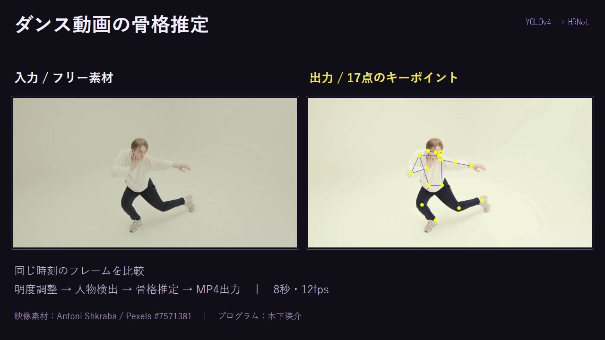

# ダンス動画の骨格推定

YOLOv4で人物を検出し、HRNetで17点の骨格を可視化するMATLABプログラム。

[作品を見る](https://eisuke29.github.io/portfolio/work10.html) · [ポートフォリオ](https://eisuke29.github.io/portfolio/)



## 処理

1. 動画をフレームに分解
2. HSVの明度を1.2倍に調整
3. YOLOv4（csp-darknet53-coco）で人物領域を検出
4. HRNet（human-full-body-w32）で17点のキーポイントを検出
5. 黄色の関節点と青色の骨格を重ね、元と同じフレームレートでMP4に書き出す

2026年5月25日提出のMATLAB課題です。コードは本人が記述し、Claudeは関数の説明・デバッグ等の支援に使用しました。

## 公開デモ

[入力と推定結果の比較映像（8秒・無音）](media/demo.mp4)

2026年11月1日にフリー素材へ差し替え、課題原本のコードで再実行しました。入力・出力はいずれも96フレーム（960×506、12fps）、処理時間は424.16秒（約7分4秒）でした。`docs/run-result.json` に条件を記載しています。

映像素材：[Antoni Shkraba / Video of a Man Dancing, Pexels #7571381](https://www.pexels.com/video/video-of-a-man-dancing-7571381/)（[Pexels License](https://www.pexels.com/license/)）。10秒地点から8秒を切り出し、解像度・フレームレート調整、明度調整、骨格描画、比較編集を行っています。素材の撮影者とプログラム作者は異なります。

## 実行方法

MATLAB R2026a / Windows 11で制作。Image Processing Toolbox、Computer Vision Toolbox、Deep Learning Toolbox、およびYOLO v4 Object Detection / Object Keypoint Detectionのモデル用アドオンが必要です。

FFmpegが使える環境で、次のコマンドをリポジトリのフォルダから実行すると、公開デモと同じ入力を準備できます。素材動画は単体で再配布せず、ダウンロード元から取得します。

```sh
python scripts/prepare_sample.py
```

MATLABで `src` を現在のフォルダにし、`MP_Dance_kadai` を実行します。`src/output_dance_2.mp4` に書き出します。自分の映像で試す場合は `src/input.mp4` として用意してください。モデル本体はMathWorksのアドオンから取得します。

## 結果と限界

激しい動きや前屈みの姿勢で検出失敗・骨格のずれがあり、明度補正による精度改善は定量的に検証していません。今回の公開デモは実際の出力を編集したものです。レポートPDFと、元の課題で使った私的な映像は収録していません。

## 参照

- [MathWorks: yolov4ObjectDetector](https://www.mathworks.com/help/vision/ref/yolov4objectdetector.html)
- [MathWorks: hrnetObjectKeypointDetector](https://www.mathworks.com/help/vision/ref/hrnetobjectkeypointdetector.html)


## 制作者・権利

木下瑛介 / Eisuke Kinoshita（[Eisuke29](https://github.com/Eisuke29)）。共同制作・外部素材については上記の説明を参照してください。自作のコード・映像・デザインについて、別途記載のない限り無断での再配布は許諾していません。外部ライブラリ・モデル・フォント等にはそれぞれのライセンスが適用されます。
